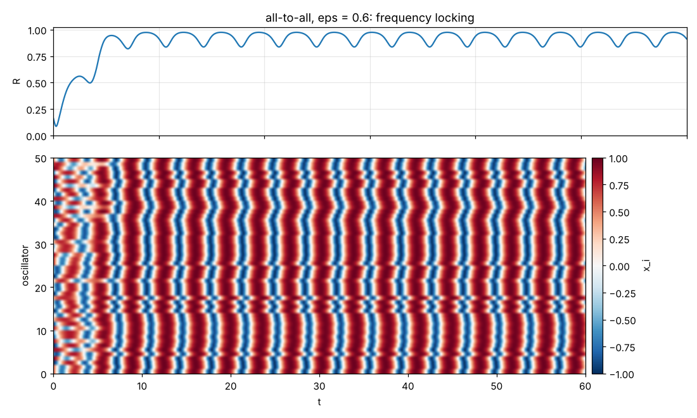
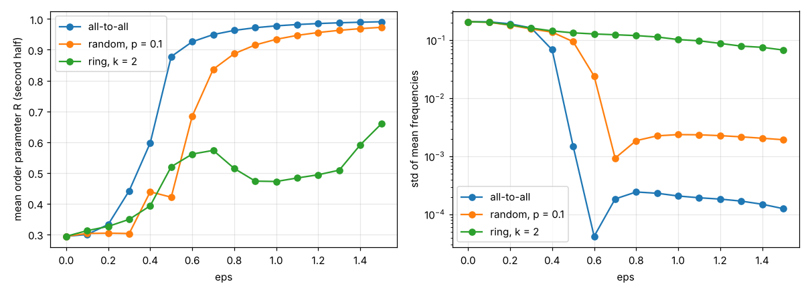

# Oscillator-Network-Simulation

Networks of coupled SNIPER oscillators with delayed feedback. The integrator is RK4 with Hermite-interpolated delays, written in header-only C++17, with a command-line tool and Python plotting.



*50 oscillators with $b_i \in [1.7, 2.3]$, all-to-all coupling with ε = 0.6. After a short transient they lock to a common frequency. Top: order parameter. Bottom: $x_i(t)$.*

## Model

Each oscillator is an active rotator in Cartesian coordinates:

$$\dot x_i = x_i(1-r_i^2) + y_i(x_i - b_i) + \varepsilon \sum_j A_{ij}(x_j - x_i) + \kappa\,\big(x_i(t-\tau) - x_i(t)\big)$$

$$\dot y_i = y_i(1-r_i^2) - x_i(x_i - b_i) + \varepsilon \sum_j A_{ij}(y_j - y_i) + \kappa\,\big(y_i(t-\tau) - y_i(t)\big)$$

In polar coordinates the uncoupled oscillator is $\dot r = r(1-r^2)$ and $\dot\varphi = b - r\cos\varphi$. On the limit cycle $r = 1$:
- **Excitable,** $|b| < 1$: the phase settles at the stable node $\cos\varphi^* = b$, $\sin\varphi^* < 0$.
- **Oscillating,** $|b| > 1$: the period is $T = 2\pi/\sqrt{b^2-1}$, diverging at the saddle-node on invariant circle (SNIPER) bifurcation $|b| = 1$.

**Terms:**
- **Coupling:** diffusive, with an adjacency matrix $A$ that is all-to-all, a ring, random, or read from a file. It can be normalised by the degree (`--normalize`).
- **Feedback:** Pyragas delayed feedback. It vanishes on any orbit with period τ (non-invasive control).
- **Legacy forms:** `--coupling legacy` and `--feedback legacy` reproduce the 2017 right-hand side:
  - coupling: $\varepsilon\sum_j A_{ij}[(x_j-x_i)+(y_j-y_i)]$, added to both $\dot x$ and $\dot y$
  - feedback: $\kappa\,x_i\,x_i(t-\tau)$

**Order parameter.** The tool reports the Kuramoto order parameter $R = |\langle e^{i\varphi_j}\rangle|$ with the geometric phase $\varphi = \operatorname{atan2}(y, x)$. SNIPER oscillators move slowly near $\varphi = 0$ and spend more time there, so even incoherent networks give $R \approx 0.3$ rather than $\approx 1/\sqrt N$. That baseline is visible in the sweep below.

**Numerics.** Classical RK4 with step `--dt`. The delayed state at stage times $t + c\,h - \tau$ comes from cubic Hermite interpolation of the stored trajectory and its derivatives:
- **On the grid** (τ a multiple of dt), the scheme converges with order 4.
- **Off the grid,** the derivative jump at $t = 0$ (history → DDE) creates a kink at $t = \tau$ that falls inside a step. That costs one small local error, about $10^{-7}$ for dt = 0.004 in the tests.

The history for $t \le 0$ is the constant initial state, or any function via `Network::prefill`.

## Build and run

```bash
sudo apt install doctest-dev   # only for the tests
make && make test

./oscnet --n 100 --b 9 --eps 0.1 --tau 2 --kappa 0.5 --t 50 --out run.csv
./oscnet --topology file:examples/Kopplungsmatrix.txt --b 2 --eps 0.3 --t 20
./oscnet --n 50 --b 2 --b-spread 0.3 --topology all --normalize --init circle --t 100 --sweep eps:0:1.5:16
python tools/plot_run.py run.csv --out run.png
python tools/plot_sweep.py "all-to-all=sweep.csv" --out sweep.png
```

CMake works too:

```bash
cmake -S . -B build && cmake --build build && ctest --test-dir build
```

**Main options:**
- `--n`: number of oscillators
- `--b`, `--b-spread`: each $b_i$ is uniform in b ± spread
- `--topology all|ring:K|random:P|file:PATH`
- `--normalize`
- `--tau`, `--kappa`
- `--dt`, `--t`
- `--seed`
- `--init square|circle`:
  - `square`: initial $x, y \sim U(0,1)$, as in 2017
  - `circle`: random phases on the unit circle

**Output.**
- *`--out`:* writes `t, R, x_0 … x_{N-1}`, plus the $y_i$ with `--write-y`, every `--every` steps.
- *`--sweep PARAM:FROM:TO:COUNT`:* sweeps `eps`, `kappa`, `tau` or `b-spread`. For each value it prints the mean $R$ over the second half of the run and the spread of the oscillators' mean frequencies.

**Coupling matrix files.** One row per line. Rows can be written either as digits (`0110…`, as in the original `Kopplungsmatrix.txt`) or as numbers separated by spaces, tabs or commas, which then become weights.

## Synchronisation experiment

Setup: 50 oscillators with $b_i \sim U(1.7, 2.3)$, so the natural frequencies $\sqrt{b_i^2-1}$ lie in 1.37–2.07. Coupling is normalised by the degree. Each value of ε is integrated to $t = 100$ with dt = 0.001 (about 1 s per run), one seed. The data are in `results/`.



- **All-to-all:** a sharp transition between ε ≈ 0.4 and 0.6. The frequency spread drops from 0.2 to $10^{-4}$, so all oscillators lock, and $R$ climbs towards 1.
- **Random graph** (p = 0.1, about 5 neighbours): the same transition, shifted to ε ≈ 0.6–0.7.
- **Ring** (2 neighbours on each side): no global locking up to ε = 1.5. The frequency spread only falls slowly, and $R$ moves non-monotonically, consistent with locally locked clusters drifting against each other. A single seed is not enough to read more into the dips.

## Changes from the 2017 version

- **The integration never really ran:**
  - The final RK4 update was applied only to oscillator 0 (`for (i = 0; i < 1; i++)`); the other 99 never moved.
  - The run (1750 × 0.001 = 1.75 time units) was shorter than the delay τ = 2, so the feedback never started.
- **Delay bugs:**
  - The delay midpoint was `a + b*0.5` instead of `(a + b)/2`.
  - τ = 0 left the delay length uninitialised and divided by zero.
- **Coupling bug:** Euler steps coupled to `oscillators[i]` instead of the actual neighbours.
- **Input and output:**
  - the coupling file name was ignored, and a missing file left the matrix uninitialised
  - output went to a hard-coded `C:/Users/...` path
  - only x was written
- **Portability:** `std::uniform_real` was non-standard, and the RNG was seeded from the time.
- **Delay accuracy:** the delayed term used linear interpolation; it is now Hermite with left/right derivatives at $t = 0$.
- **New:**
  - order parameter and mean frequencies
  - heterogeneous $b_i$, topologies and sweeps
  - doctest tests under ASan and UBSan in CI
  - plotting tools

The tests cover:
- the analytic period $2\pi/\sqrt{b^2-1}$ (to $10^{-6}$)
- the excitable fixed point
- RK4 order 4, with and without delay
- Pyragas non-invasiveness on the exact periodic orbit
- synchronisation vs no coupling
- the legacy right-hand side
- graph construction and matrix files
